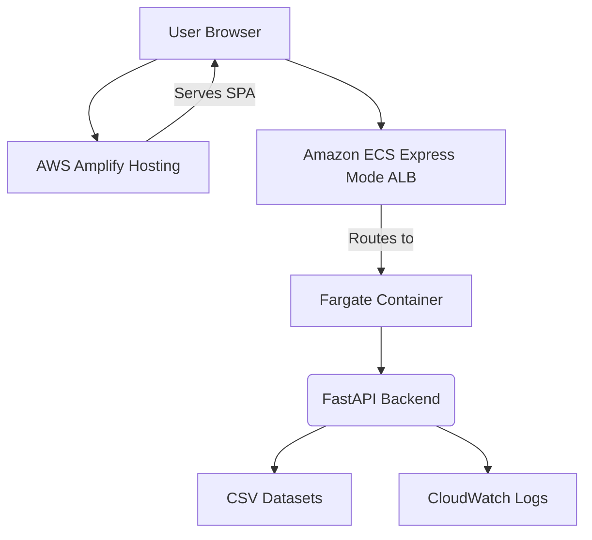

# WATER SHADOW — Environmental Intelligence

**Analyzing agricultural water footprints, crop production, and groundwater stress in India**

WATER SHADOW is a full-stack platform that explores connections between agricultural production, export-related water footprints, and groundwater stress to support sustainable water resource planning.

**Live Frontend**: https://main.dyetbitfqk9ms.amplifyapp.com
**Backend Health**: https://wa-82bc2107aee34e5a9c0bf5342fced588.ecs.ap-southeast-2.on.aws/health
**Data Status**: https://wa-82bc2107aee34e5a9c0bf5342fced588.ecs.ap-southeast-2.on.aws/api/v1/data-status

---

## Table of Contents
- [Problem & Users](#problem-statement-and-intended-users)
- [Features](#features)
- [Architecture](#architecture)
- [Tech Stack](#technology-stack)
- [AWS Deployment](#aws-deployment)
- [Data & Methods](#dataset-inventory-and-provenance)
- [Local Setup](#local-development-and-installation)
- [API Reference](#api-reference)
- [Testing](#testing-and-quality-checks)
- [Limitations](#limitations-and-responsible-use)
- [Team](#team-and-hackathon)

---

## Problem Statement and Intended Users

Agricultural production impacts water resources through direct consumption and virtual water in exports. Understanding these connections is vital for sustainable planning, but datasets are often siloed.

WATER SHADOW integrates official export statistics, crop production data, groundwater assessments, and water footprint coefficients to enable:

- **Researchers**: Explore water-agriculture nexus questions
- **Students/Analysts**: Learn about virtual water trade and sustainability
- **Practitioners**: Assess supply chain water risks
- **Policy Analysts**: Evaluate agricultural water productivity scenarios

*Note: Platform supports exploration—not real-world impact measurement.*

---

## Features

- **Dashboard**: Key metrics overview (exports, production, groundwater)
- **Export Water Footprint**: Analyze water footprints of ag exports by crop/year
- **Regional Explorer**: View crop production & groundwater data by region (tabular—no spatial data available)
- **Crop-Shift Simulator**: Model water impact of changing crop patterns
- **Resource Optimization**: Optimize crop allocation to minimize water usage
- **Sensitivity Analysis**: Test how input variations affect outputs
- **Explain Analysis**: Trace calculation steps for transparency
- **Decision Receipts**: Generate audit trails for analytical work
- **Data & Methodology**: Reference on sources, limitations, and methods

---

## Architecture



**Flow**: Browser → Frontend → API → Backend (ECS/Fargate) → CSV Data → JSON Response → Frontend Visualization

---

## Technology Stack

- **Frontend**: React 19, TypeScript, Vite, Recharts, Tailwind CSS
- **Backend**: Python 3.11, FastAPI, Uvicorn, Pandas
- **Data**: Pandas, NumPy (analysis), SciPy (optimization)
- **Testing**: Pytest (backend), Vitest (frontend)
- **Deployment**: Docker, AWS Amplify (frontend), ECS Express Mode (backend), ECR, CloudWatch

---

## AWS Deployment

- **Frontend**: AWS Amplify Hosting (React/Vite SPA)
- **Backend**: Amazon ECS Express Mode (Fargate + ALB with HTTPS)
- **Storage**: Amazon ECR (container images)
- **Monitoring**: Amazon CloudWatch (logs/metrics)

**Env Vars**:
- `VITE_API_BASE_URL`: Backend URL (dev: `http://localhost:8000`)
- `FRONTEND_ORIGINS`: CORS origins (dev: localhost URLs)

*Monorepo: `frontend/` (Amplify root), `ml_service/` (FastAPI)*

---

## Data & Methods

| Dataset | Rows | Scope |
|---------|------|-------|
| Agricultural Exports | 3 | APEDA FY 2024-25 (Non-Basmati/Basmati Rice, Wheat) |
| Crop Water Footprint | 20 | Mekonnen & Hoekstra (1996-2005) global averages |
| Crop Production | 40 | State-level rice/wheat FY 2023-24 & FY 2024-25 |
| Groundwater Assessment | 5 | Ludhiana, Punjab 2022 (all Over-Exploited) |

**Key Notes**:
- Export data: APEDA product aggregates (not destination-specific)
- Water Footprint: m³/tonne; Grey water = pollution assimilation (not consumption)
- Crop Proxies: Basmati/non-basmati rice use global rice coefficients (indicative only)
- Groundwater: 5 Punjab units only—no coordinates/boundaries in dataset
- No national coverage—users must consider geographic/temporal mismatches

**Methodology**:
- Water Footprint = Quantity × Coefficient (m³)
- Green: Rainwater consumed | Blue: Surface/groundwater consumed | Grey: Pollution dilution volume
- Scenarios: Linear water footprint comparisons
- Optimization: Linear programming (min blue/green/grey water)
- Sensitivity: Parameter variation to assess result stability
- Provenance: OBSERVED (source data), PUBLISHED (coefficients), INFERRED (calculations/assumptions)

---

## Local Setup

### Prerequisites
- Python 3.11+
- Node.js 18+
- npm 9+

### Backend
```bash
git clone <repo>
cd <repo>
python -m venv venv
# PowerShell: .\venv\Scripts\Activate.ps1
# bash/zsh: source venv/bin/activate
pip install -r requirements.txt
```

### Frontend
```bash
cd frontend
npm ci
```

### Run
```bash
# From repo root (starts both):
npm start
# Backend: http://localhost:8000 | Frontend: http://localhost:5173
```

---

## API Reference

Core endpoints (`/api/v1`):

- `GET /health` → Service status
- `GET /data-status` → Dataset availability
- `GET /exports/ledger?crop=basmati%20rice&financial_year=2024-25&water_component=all` → Export water footprint
- `GET /regions/crop-production?state=Punjab&crop=rice&year=2024-25` → Production stats
- `GET /regions/groundwater-stress?state=Punjab&year=2022` → Groundwater data
- `POST /scenarios/crop-shift` → Crop shift simulation (JSON body)
- `POST /optimization/crop-allocation` → Resource optimization (JSON body)
- `POST /analysis/sensitivity` → Sensitivity analysis (JSON body)
- `POST /analysis/explain` → Explain results (JSON body)
- `POST /receipts/` → Generate decision receipt (JSON body)

*Interactive docs: `/docs` (Swagger) or `/redoc` (ReDoc)*

---

## Testing

**Backend** (`pytest ml_service/tests -v`):
- 37 tests passing (data loading, API routes, analysis services)

**Frontend** (`cd frontend && npm test`):
- 39 tests passing across 7 test files (components, pages, API client)

**Build** (`cd frontend && npm run build`):
- Production bundle generated successfully (~1.3MB gzipped)

---
