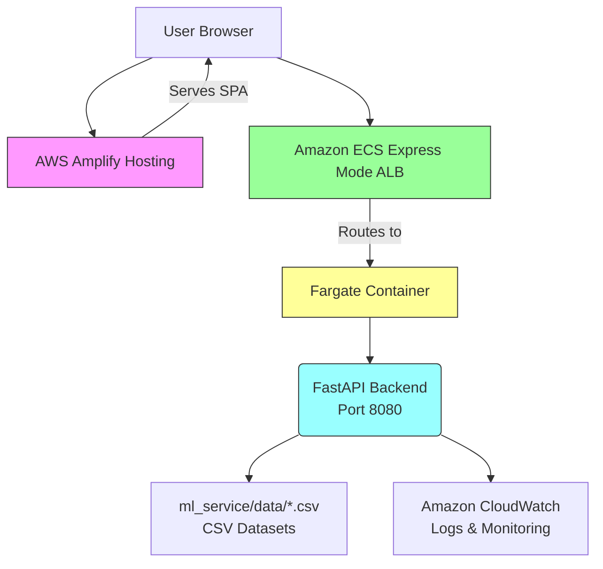

# WATER SHADOW — Environmental Intelligence

**Environmental intelligence platform for agricultural water footprint analysis, crop production insights, and groundwater assessment in India**

WATER SHADOW is a full-stack analytical platform that helps users explore the connections between agricultural production, export-related water footprints, and groundwater stress. The platform enables data-driven exploration of agricultural water usage patterns to support sustainable water resource planning.

**Live Frontend**: https://main.dyetbitfqk9ms.amplifyapp.com
**Backend Health Check**: https://wa-82bc2107aee34e5a9c0bf5342fced588.ecs.ap-southeast-2.on.aws/health
**Backend Dataset Status**: https://wa-82bc2107aee34e5a9c0bf5342fced588.ecs.ap-southeast-2.on.aws/api/v1/data-status

---

## Table of Contents
- [Problem Statement and Intended Users](#problem-statement-and-intended-users)
- [Features](#features)
- [Screenshots](#screenshots)
- [Architecture](#architecture)
- [Technology Stack](#technology-stack)
- [AWS Deployment](#aws-deployment)
- [Dataset Inventory and Provenance](#dataset-inventory-and-provenance)
- [Scientific Methodology](#scientific-methodology)
- [Local Development and Installation](#local-development-and-installation)
- [Environment Variables](#environment-variables)
- [API Reference](#api-reference)
- [Testing and Quality Checks](#testing-and-quality-checks)
- [Repository Structure](#repository-structure)
- [Limitations and Responsible Use](#limitations-and-responsible-use)
- [Roadmap and Contribution Guidelines](#roadmap-and-contribution-guidelines)
- [Team and Hackathon](#team-and-hackathon)
- [License](#license)

---

## Problem Statement and Intended Users

Agricultural production in India significantly impacts water resources through both direct consumption and virtual water embedded in exports. Understanding the relationship between crop production patterns, agricultural exports, and groundwater stress is essential for sustainable water resource planning. However, these datasets are often siloed, making it difficult to explore their interconnected dynamics.

WATER SHADOW addresses this challenge by integrating official agricultural export statistics, crop production data, groundwater assessments, and established water footprint coefficients into a unified analytical platform. The application supports:

- **Environmental researchers** exploring water-agriculture nexus questions
- **Students and analysts** learning about virtual water trade and resource sustainability
- **Sustainability practitioners** assessing supply chain water risks
- **Policy analysts** evaluating agricultural water productivity scenarios

The platform enables data exploration, comparative analysis, and scenario modeling—but does not claim to have measured real-world impacts on water consumption, crop yields, or policy changes. Instead, it provides an evidence-based exploration environment for understanding potential relationships and trade-offs.

---

## Features

WATER SHADOW provides the following analytical capabilities through an intuitive web interface:

### Dashboard
Overview section displaying key metrics from the integrated datasets, including total export volumes, production statistics, and groundwater assessment summaries for quick reference.

### Export Water Footprint
Analyze the water footprint associated with agricultural exports:
- Select specific crops (basmati rice, non-basmati rice, wheat) and financial years
- View green, blue, and grey water footprint components
- Results presented in cubic meters with clear provenance tracking (OBSERVED, PUBLISHED, INFERRED)
- Understand that grey water represents pollution assimilation volume, not physical water consumption

### Regional Explorer
Access crop production and groundwater data by geographical region:
- Select states to view rice and wheat production statistics (area, production, yield)
- Examine groundwater assessment categories (Safe, Semi-Critical, Critical, Over-Exploited)
- **Important limitation**: Geographic coordinates and verified boundary geometries are not available in the current dataset. The application maintains scientific integrity by presenting non-spatial assessment-unit views instead of fabricating map points. Data is presented in tabular format organized by assessment units.

### Crop-Shift Simulator
Model the water impact of shifting from one crop to another:
- Define region, baseline crop, alternative crop, area (hectares), and reference year
- Compare water footprint differences between crops
- Understand limitations: uses historical global-average coefficients (1996–2005) and rice/paddy proxy assumptions for basmati/non-basmati categories

### Resource Optimization
Find optimal crop allocations to minimize water usage:
- Specify region, objective (minimize blue water, minimize green water, etc.), and time period
- Apply constraints such as minimum production requirements
- Results based on linear optimization of available crop production data

### Sensitivity Analysis
Explore how variations in input parameters affect outputs:
- Vary parameters like crop yield, export volume, or water footprint coefficients
- Visualize results across multiple steps to understand uncertainty propagation
- Helps identify which assumptions have the greatest impact on conclusions

### Explain Analysis
Understand how specific results are calculated:
- Trace calculation steps for any analysis
- See provenance tags for each data component used
- Promotes transparency in analytical workflows

### Decision Receipts
Generate audit trails for analytical work:
- Create detailed records of analyses performed
- Include parameters, results, data sources, and methodology notes
- Supports reproducibility and documentation of exploratory work

### Data & Methodology
Reference section detailing:
- Complete dataset inventory with sources, scope, and limitations
- Water footprint methodology explanations
- Clear definitions of green, blue, and grey water components
- Assumptions and uncertainties inherent in the analysis

---

## Screenshots

No actual screenshots are currently present in the repository. To enhance documentation, consider adding screenshots of:
1. Dashboard showing integrated metrics overview
2. Export Water Footprint analysis results
3. Regional Explorer tabular data presentation
4. Crop-Shift Simulator interface
5. Resource Optimization results
6. Sensitivity Analysis visualization
7. Explain Analysis detailed breakdown
8. Decision Receipts generation interface

Screenshots should be captured from the live deployment or local development environment and added to the repository with descriptive alt text.

---

## Architecture

WATER SHADOW follows a modern client-server architecture with containerized deployment on AWS:



**Request Flow**:
1. User interacts with React/Vite frontend in browser
2. Frontend makes HTTP API requests to backend service
3. Amazon ECS Express Mode routes requests to Fargate container
4. FastAPI processes requests, accesses CSV datasets, and returns JSON responses
5. Frontend visualizes data using Recharts and presents insights to user

**Key Technologies**:
- **Frontend**: React 19, TypeScript, Vite, Recharts, Leaflet, React-Leaflet, React Query, Tailwind CSS
- **Backend**: Python 3.11, FastAPI, Uvicorn, Pydantic, Pandas, NumPy
- **Containerization**: Docker, Amazon ECR
- **AWS Hosting**: AWS Amplify (frontend), Amazon ECS Express Mode (backend)
- **Monitoring**: Amazon CloudWatch

---

## Technology Stack

### Frontend and UI
- **React 19** - Component library for building user interfaces
- **TypeScript** - Typed superset of JavaScript for enhanced developer experience
- **Vite** - Modern frontend build tool providing fast development experience
- **React Query** - Data synchronization and state management
- **Recharts** - Charting library built on D3 for data visualizations
- **Leaflet & React-Leaflet** - Interactive mapping capabilities (currently used for potential future spatial features)
- **Lucide React** - Icon set for consistent UI elements
- **React Router DOM** - Client-side routing for SPA navigation
- **Tailwind CSS** - Utility-first CSS framework for styling

### Backend and API
- **FastAPI** - Modern Python web framework for building APIs
- **Uvicorn** - ASGI server for running FastAPI applications
- **Pydantic** - Data validation and settings management
- **Python Multipart** - Handling of form data in API requests

### Data Processing and Analytics
- **Pandas** - Data manipulation and analysis library
- **NumPy** - Numerical computing foundation for Pandas
- **SciPy** - Scientific computing algorithms used in optimization routines

### Testing
- **Pytest** - Backend testing framework
- **Vitest** - Frontend testing framework (Vite-native)
- **Testing Library** - Frontend component testing utilities
- **JS DOM** - JavaScript implementation of DOM standards for testing

### Containerization
- **Docker** - Container platform for consistent deployment
- **Multi-stage build** - Optimized Docker image construction

### AWS Hosting and Deployment
- **AWS Amplify** - Hosting for React/Vite frontend with CI/CD
- **Amazon ECS Express Mode** - Serverless container deployment for backend
- **Amazon ECR** - Container image storage and distribution
- **Amazon CloudWatch** - Logging, monitoring, and operational insights

---

## AWS Deployment

WATER SHADOW is deployed using AWS managed services following infrastructure-as-code principles:

### AWS Amplify Hosting
- Hosts the React/Vite frontend application
- Integrated with GitHub for continuous deployment
- Automatically runs `npm ci` and `npm run build` on code pushes
- Provides global CDN distribution with HTTPS

### Amazon ECS Express Mode
- Runs the containerized FastAPI backend using AWS Fargate (serverless compute)
- Automatically provisions Application Load Balancer with HTTPS/TLS termination
- Manages service discovery, scaling, and load balancing
- Exposes backend API at port 8080 with health check endpoint `/health`

### Amazon ECR
- Stores the backend Docker image (`water-shadow-backend:latest`)
- Enables secure, scalable container image management
- Integrated with ECS Express Mode for seamless deployments

### Amazon CloudWatch
- Captures application logs from both frontend and backend
- Provides metrics for monitoring system health and performance
- Enables operational visibility and troubleshooting capabilities

### Environment Variables
The application relies on two key environment variables for frontend-backend communication:

**`VITE_API_BASE_URL`**
- Used during frontend build to configure API endpoint
- In development: defaults to `http://localhost:8000`
- In production: set to the Amazon ECS service URL (e.g., `https://wa-82bc2107aee34e5a9c0bf5342fced588.ecs.ap-southeast-2.on.aws`)
- Must not include trailing slash or `/api/v1` prefix

**`FRONTEND_ORIGINS`**
- Configured on backend for CORS policy
- In development: includes localhost origins (`http://localhost:5173`, `http://127.0.0.1:5173`)
- In production: set to the Amplify frontend URL (e.g., `https://main.dyetbitfqk9ms.amplifyapp.com`)
- Multiple origins can be specified as comma-separated values

**Monorepo Structure**
The project follows a monorepo structure where:
- `frontend/` directory contains the React/Vite application (app root for Amplify)
- `ml_service/` directory contains the FastAPI backend application
- Root directory contains Dockerfile, amplify.yml, and deployment documentation

---

## Dataset Inventory and Provenance

WATER SHADOW integrates four core datasets with documented provenance and limitations:

| Dataset | Rows | Scope | Key Details |
|---------|------|-------|-------------|
| **Agricultural Exports** | 3 | APEDA product aggregates, FY 2024–25 | Non-Basmati Rice, Basmati Rice, Wheat quantities in tonnes; values converted from USD millions to USD thousands; source: APEDA Annual Administrative Report 2024-25, section 2.6 |
| **Crop Water Footprint** | 20 | Historical global-average coefficients, 1996–2005 | Green, blue, grey water in m³/tonne; source: Mekonnen & Hoekstra (2011); includes rice/paddy proxy mappings for basmati/non-basmati rice (not product-specific coefficients) |
| **Crop Production** | 40 | State-level rice and wheat records, FY 2023–24 and FY 2024–25 | Major-producing states from Government of India DES Agricultural Statistics; area converted from million hectares to hectares; production from million tonnes to tonnes |
| **Groundwater Assessment** | 5 | Ludhiana, Punjab, assessment year 2022 | Five assessment units in Ludhiana district, all classified as Over-Exploited; source: Central Ground Water Board Punjab 2022 report; assessment unit IDs are locally generated (not official CGWB IDs) |

### Important Provenance Notes

**Agricultural Exports**
- Uses APEDA's official Annual Administrative Report 2024-25
- Quantities published in metric tonnes, values in USD millions (converted to USD thousands)
- APEDA categories are product aggregates, not detailed HS codes or destination-specific data

**Crop Water Footprint**
- Published global-average coefficients from Mekonnen & Hoekstra (2011), study period 1996–2005
- Grey water is pollution-assimilation indicator (m³/tonne), not physical water consumption
- `basmati rice` and `non-basmati rice` rows use global `rice, paddy` values as proxy mappings (inferred, not published product-specific)
- Any export footprint using these proxies should be treated as indicative, not definitive

**Crop Production**
- Extracted from Government of India DES `Agricultural Statistics at a Glance 2024-25`
- Includes only major-producing states listed in source tables (not nationwide district coverage)
- District field is blank because source provides state-level data only
- Unit conversions may introduce minor rounding differences

**Groundwater Assessment**
- Contains five named assessment units in Ludhiana district from Punjab 2022 groundwater report
- All five units reported as Over-Exploited in the source
- Latitude and longitude fields are intentionally left blank (no coordinates guessed)
- Assessment unit IDs are locally generated keys based on state, district, unit name, and year
- Represents only a five-unit Punjab subset, not nationwide coverage

**Critical Limitations**: The application does not present these starter datasets as complete national censuses. Users must consider the different geographic and temporal coverages when interpreting results. No causal attribution between crop production and groundwater conditions should be inferred merely because both datasets reference the same state or district.

---

## Scientific Methodology

### Water Footprint Estimation
WATER SHADOW calculates water footprints using the established volumetric approach:

**Water Footprint (m³) = Quantity (tonnes) × Water Footprint Coefficient (m³/tonne)**

Where coefficients represent:
- **Green water**: Rainwater consumed by crops (effective rainfall used for growth)
- **Blue water**: Surface and groundwater consumed by crops (irrigation water)
- **Grey water**: Theoretical volume of water required to assimilate pollutants based on:
  - Pollutant load
  - Ambient water quality standards
  - Natural pollutant concentration in receiving water body
  - *Not an actual water withdrawal or consumption*

### Green, Blue, and Grey Water Components
- **Green water**: Represents rainfall-derived water stored in soil and consumed by plants through transpiration. Important for rainfed agriculture.
- **Blue water**: Represents freshwater sourced from surface water bodies (rivers, lakes) or groundwater aquifers for irrigation. Represents actual water abstraction.
- **Grey water**: Represents the volume of water needed to dilute pollutants to acceptable quality standards. It is an indicator of water pollution potential, not a physical water flow. Higher grey water indicates greater pollution burden per unit of production.

### Crop-Shift Scenarios
Simulates water impact of changing crop patterns:
```
ΔWF = (WF_alternative - QF_baseline) × Area
```
Where WF is water footprint per tonne for each crop component. Results show potential water savings or increases from changing cultivation patterns.

### Resource Optimization
Uses linear programming to optimize crop allocation:
- **Objective functions**: Minimize total blue water, green water, or grey water
- **Decision variables**: Hectares allocated to each crop
- **Constraints**: Minimum production requirements, total available land, non-negativity
- **Solution**: Optimal hectare allocation meeting constraints while minimizing selected water metric

### Sensitivity Analysis
Variates key parameters to assess result stability:
- Parameters: Crop yield, export volume, water footprint coefficients
- Method: Systematic variation (±X% in N steps) while holding other inputs constant
- Output: Shows how output metric changes across parameter range
- Purpose: Identifies which assumptions most influence conclusions

### Analytical Explanation and Decision Records
- **Explain Analysis**: Provides step-by-step calculation breakdown for any result
- **Decision Receipts**: Generates structured records capturing:
  - Analysis type and parameters
  - Input data sources and provenance tags
  - Calculation methodology
  - Numerical results with units
  - Timestamp and user context

### Key Distinctions and Uncertainties
- **Source observations** (e.g., export quantities) vs. **model estimates** (e.g., water footprints)
- **Historical coefficients** (1996–2005) applied to contemporary trade data
- **Proxy assumptions** for basmati/non-basmati rice using global rice paddy values
- **Scenario outputs** are exploratory, not predictive
- **Uncertainty sources**: Coefficient applicability, proxy accuracy, temporal mismatches, spatial aggregation

Users should treat results as indicative explorations rather than definitive measurements, recognizing that real-world water footprints vary based on local climate, irrigation practices, soil types, and agricultural techniques.

---

## Local Development and Installation

### Prerequisites
- **Python 3.11+** (tested with 3.11.9)
- **Node.js 18+** (tested with v20.11.0)
- **npm 9+** (comes with Node.js)
- **Git** (for cloning repository)

### Backend Setup
```bash
# Clone repository
git clone <repository-url>
cd <repository-directory>

# Create and activate virtual environment
python -m venv venv
# Windows PowerShell:
.\venv\Scripts\Activate.ps1
# bash/zsh:
source venv/bin/activate

# Install backend dependencies
pip install -r requirements.txt

# Set development environment variables (optional)
# Create .env file with:
# FRONTEND_ORIGINS=http://localhost:5173,http://127.0.0.1:5173
```

### Frontend Setup
```bash
# In separate terminal, navigate to frontend directory
cd frontend

# Install frontend dependencies
npm ci

# Development environment variables are handled automatically by Vite
# For explicit configuration, create .env file with:
# VITE_API_BASE_URL=http://localhost:8000
```

### Running the Application

#### Option 1: Simultaneous Start (Recommended)
```bash
# From repository root
npm start
```
This concurrently starts:
- Backend: FastAPI on `http://localhost:8000`
- Frontend: Vite dev server on `http://localhost:5173`

#### Option 2: Individual Services

**Backend Only:**
```bash
# From repository root
npm run backend
# Or manually:
.\venv\Scripts\Activate.ps1  # Windows
uvicorn ml_service.app.main:app --reload --host 0.0.0.0 --port 8000
```

**Frontend Only:**
```bash
# From frontend directory
npm run dev
# Or:
npm run frontend
# Or manually:
cd frontend
npm run dev
```

### Accessing the Application
- Frontend: http://localhost:5173
- Backend API docs: http://localhost:8000/docs
- Backend health check: http://localhost:8000/health

### Notes
- Backend automatically reloads on code changes during development
- Frontend uses Vite's hot module replacement for instant updates
- CORS is configured to allow local development origins by default
- Production builds require setting `VITE_API_BASE_URL` to the deployed backend URL

---

## Environment Variables

The application uses two environment variables for configuration:

### `VITE_API_BASE_URL`
- **Purpose**: Configures the backend API URL for frontend requests
- **Development**: `http://localhost:8000` (default if not set)
- **Production**: Set to deployed backend URL (e.g., `https://wa-82bc2107aee34e5a9c0bf5342fced588.ecs.ap-southeast-2.on.aws`)
- **Important**: Must NOT include trailing slash or `/api/v1` prefix
- **Usage**: Accessed via `import.meta.env.VITE_API_BASE_URL` in Vite
- **Build-time**: Value is baked into frontend during build process

### `FRONTEND_ORIGINS`
- **Purpose**: Configures CORS policy on backend for security
- **Development**: `http://localhost:5173,http://127.0.0.1:5173` (default if not set)
- **Production**: Set to deployed frontend URL(s) (e.g., `https://main.dyetbitfqk9ms.amplifyapp.com`)
- **Format**: Comma-separated list of origins without trailing slashes
- **Security**: Never allows wildcard (`*`) origins in production
- **Usage**: Parsed by backend `get_allowed_origins()` function in `main.py`

### Implementation Verification
Both variables are implemented as described:
- Frontend: Uses `import.meta.env.VITE_API_BASE_URL` in API client
- Backend: `get_allowed_origins()` function in `main.py` parses `FRONTEND_ORIGINS`
- Default values provide safe local development experience
- Production behavior matches deployment documentation

No other environment variables are required for core functionality. Secrets, API keys, or database credentials are not used as the application relies on embedded CSV datasets.

---

## API Reference

WATER SHADOW provides a RESTful API for programmatic access to all analytical features. The backend serves JSON responses at the base path `/api/v1`.

### Health
- **GET** `/health`
- **Purpose**: Service health check
- **Response**: `{ "status": "healthy", "timestamp": "ISO string" }`
- **Example**: 
  ```bash
  curl https://wa-82bc2107aee34e5a9c0bf5342fced588.ecs.ap-southeast-2.on.aws/health
  # Returns: {"status":"healthy","timestamp":"2026-10-12T10:30:00Z"}
  ```

### Data Status
- **GET** `/api/v1/data-status`
- **Purpose**: Dataset availability and system readiness
- **Response**: Object with dataset names as keys and availability status
- **Example**: 
  ```bash
  curl https://wa-82bc2107aee34e5a9c0bf5342fced588.ecs.ap-southeast-2.on.aws/api/v1/data-status
  # Returns: {"agricultural_exports":true,"crop_water_footprint":true,"crop_production":true,"groundwater_assessment":true}
  ```

### Exports
- **GET** `/api/v1/exports/ledger`
- **Purpose**: Calculate export-associated water footprint estimates
- **Parameters**:
  - `crop` (string): basmati rice, non-basmati rice, or wheat
  - `financial_year` (string): e.g., "2024-25"
  - `water_component` (string): green, blue, grey, or all
- **Response**: `{ "crop": string, "financial_year": string, "water_component": string, "quantity_tonnes": number, "water footprint_m3": number, "provenance": string }`
- **Example Request**: 
  ```bash
  curl "https://wa-82bc2107aee34e5a9c0bf5342fced588.ecs.ap-southeast-2.on.aws/api/v1/exports/ledger?crop=basmati%20rice&financial_year=2024-25&water_component=all"
  ```
- **Example Response**:
  ```json
  {
    "crop": "basmati rice",
    "financial_year": "2024-25",
    "water_component": "all",
    "quantity_tonnes": 6065456,
    "water footprint_m3": 17687588416,
    "provenance": "MIXED: OBSERVED export quantity, PUBLISHED global coefficient, INFERRED basmati proxy"
  }
  ```

### Regions
- **GET** `/api/v1/regions/crop-production`
  - **Purpose**: Regional crop production statistics
  - **Parameters**: `state` (string, optional), `crop` (string, optional), `year` (string, optional)
  - **Response**: Array of objects with state, district, crop, year, area, production, yield
- **GET** `/api/v1/regions/groundwater-stress`
  - **Purpose**: Groundwater assessment data
  - **Parameters**: `state` (string, optional), `district` (string, optional), `category` (string, optional), `year` (string, optional)
  - **Response**: Array of objects with assessment_unit_id, state, district, category, year
- **GET** `/api/v1/regions/overview`
  - **Purpose**: Combined regional overview
  - **Parameters**: `state` (string, optional), `year` (string, optional)
  - **Response**: Object with production and groundwater summaries

### Scenarios
- **POST** `/api/v1/scenarios/crop-shift`
  - **Purpose**: Crop shift scenario simulation
  - **Body**: 
    ```json
    {
      "region": "Punjab",
      "baseline_crop": "rice",
      "alternative_crop": "wheat",
      "area_hectares": 100.0,
      "reference_year": "2024-25"
    }
    ```
  - **Response**: `{ "baseline_water_m3": number, "alternative_water_m3": number, "difference_m3": number, "percent_change": number, "breakdown": { "green": {...}, "blue": {...}, "grey": {...} } }`

### Optimization
- **POST** `/api/v1/optimization/crop-allocation`
  - **Purpose**: Resource optimization for crop allocation
  - **Body**: 
    ```json
    {
      "region": "Punjab",
      "objective": "minimize_blue_water",
      "time_period": "2024-25",
      "constraints": { "min_production_rice": 1000000 }
    }
    ```
  - **Response**: `{ "allocation": { "rice": number_hectares, "wheat": number_hectares }, "total_water_m3": number, "objective_value": number }`

### Analysis
- **POST** `/api/v1/analysis/sensitivity`
  - **Purpose**: Sensitivity analysis
  - **Body**: 
    ```json
    {
      "analysis_type": "export_water_footprint",
      "parameter_to_vary": "export_quantity",
      "baseline_value": 6065456,
      "variation_percent": 20,
      "steps": 10
    }
    ```
  - **Response**: `{ "parameter_values": [...], "results": [...] }`

- **POST** `/api/v1/analysis/explain`
  - **Purpose**: Explain analysis results
  - **Body**: 
    ```json
    {
      "analysis_type": "export_water_footprint",
      "analysis_id": "export-123",
      "parameters": { "crop": "basmati rice", "financial_year": "2024-25" }
    }
    ```
  - **Response**: `{ "steps": [...], "final_result": number, "provenance_chain": [...] }`

### Receipts
- **POST** `/api/v1/receipts/`
  - **Purpose**: Generate decision receipt
  - **Body**: 
    ```json
    {
      "analysis_type": "crop_shift_scenario",
      "parameters": { "region": "Punjab", "baseline_crop": "rice", "alternative_crop": "wheat", "area_hectares": 100 },
      "result_data": { "water_difference_m3": -1234567 }
    }
    ```
  - **Response**: `{ "receipt_id": string, "generated_at": string, "content": string }`

### Interactive Documentation
FastAPI provides automatic interactive documentation:
- **Swagger UI**: `http://localhost:8000/docs` (local) or deployed equivalent
- **ReDoc**: `http://localhost:8000/redoc` (local) or deployed equivalent
- Shows all endpoints, parameters, response schemas, and example values

---

## Testing and Quality Checks

### Backend Tests
```bash
# From repository root
pip install -r requirements.txt
pytest ml_service/tests -v
```
**Results**: 37 tests passed
- Covers data loading, API routes, export analysis, regional analysis, scenarios, optimization, sensitivity analysis, explanation engine, and receipt generation
- Tests use actual CSV datasets to verify end-to-end functionality

### Frontend Tests
```bash
# From frontend directory
npm ci
npm test
```
**Results**: 39 tests passed across 7 test files
- Tests API client functions, component rendering, navigation, formatters, and page-specific logic
- Uses Vitest with Testing Library for React component testing

### Production Build
```bash
# From frontend directory
npm run build
```
**Results**: Production bundle successfully generated in `frontend/dist`
- Output includes optimized HTML, CSS, and JavaScript assets
- Bundle size: ~1.3MB gzipped (HTML: 0.7KB, CSS: 8.6KB, JS: 282.5KB)
- Warning: Some chunks exceed 500KB suggesting opportunity for code-splitting (acceptable for MVP)

### Linting
```bash
# Frontend linting (from frontend directory)
npm run lint
```
Uses Oxlint for TypeScript/JavaScript code quality checking

### Quality Assurance
All tests pass in the current repository state, indicating:
- Backend services correctly load and process CSV datasets
- API endpoints return expected response formats
- Frontend components render correctly with mock and real data
- Build process produces deployable production assets
- No known regressions in core functionality

---

## Repository Structure

```
water-shadow-amazon/
├── frontend/                   # React/Vite single-page application
│   ├── src/                    # Source code
│   │   ├── components/         # Reusable UI components
│   │   ├── pages/              # Page components (exports, regions, etc.)
│   │   ├── test/               # Unit and integration tests
│   │   ├── App.tsx             # Root application component
│   │   └── main.tsx            # Application entry point
│   ├── public/                 # Static assets
│   ├── index.html              # HTML template
│   ├── package.json            # Frontend dependencies and scripts
│   ├── tsconfig.json           # TypeScript configuration
│   └── vite.config.ts          # Vite configuration
│
├── ml_service/                 # FastAPI backend application
│   ├── app/                    # Application package
│   │   ├── main.py             # FastAPI application factory
│   │   ├── api/                # API route definitions
│   │   │   ├── routes/         # Individual route modules
│   │   │   │   ├── health.py
│   │   │   │   ├── metadata.py
│   │   │   │   ├── data_status.py
│   │   │   │   ├── exports.py
│   │   │   │   ├── regions.py
│   │   │   │   ├── scenarios.py
│   │   │   │   ├── optimization.py
│   │   │   │   ├── analysis.py
│   │   │   │   └── receipts.py
│   │   ├── services/           # Business logic services
│   │   │   ├── sensitivity_analysis_service.py
│   │   │   ├── explanation_engine_service.py
│   │   │   └── receipt_builder_service.py
│   │   ├── schemas/            # Pydantic models for request/response validation
│   │   └── data/               # Embedded CSV datasets
│   │       ├── agricultural_exports.csv
│   │       ├── crop_water_footprint.csv
│   │       ├── crop_production.csv
│   │       ├── groundwater_assessment.csv
│   │       └── README_Water_Shadow_Data_Pack.md
│   └── requirements.txt        # Python dependencies
│
├── Dockerfile                  # Container image definition for ECS
├── amplify.yml                 # AWS Amplify build configuration
├── DEPLOY_AWS.md               # AWS deployment guide
└── README.md                   # Project documentation (this file)
```

**Key Directories**:
- `frontend/src/`: Contains all frontend source code organized by feature
- `ml_service/app/api/routes/`: Contains individual API endpoint implementations
- `ml_service/app/services/`: Contains specialized analytical services
- `ml_service/app/schemas/`: Contains data validation models
- `ml_service/data/`: Contains the four core CSV datasets with documentation

---

## Limitations and Responsible Use

### Data Limitations
- **Starter Dataset Coverage**: All datasets are intentionally limited samples, not comprehensive national datasets
  - Agricultural exports: 3 product categories for FY 2024-25 only
  - Crop water footprint: 20 global historical coefficients (1996-2005), not India-specific
  - Crop production: 40 state-level ML records for rice/wheat FY 2023-24 and FY 2024-25
  - Groundwater assessment: 5 assessment units in Ludhiana district, Punjab 2022 only
- **Geographic Coverage**: Datasets cover different geographic areas (national exports, state-level production, district-level groundwater)
- **Temporal Coverage**: Mix of contemporary (exports, production) and historical (water footprint coefficients) data
- **Spatial Resolution**: No district-level production data; groundwater data limited to specific assessment units

### Methodological Limitations
- **Water Footprint Coefficients**: Uses published global averages (Mekonnen & Hoekstra 2011) that may not reflect Indian agro-climatic conditions
- **Crop Proxies**: Basmati/non-basmati rice use global rice paddy coefficients as inferred proxies (not product-specific values)
- **Grey Water Interpretation**: Represents pollution assimilation volume, not actual water consumption or withdrawal
- **Scenario Assumptions**: Linear water footprint relationships, ignoring potential economies of scale or threshold effects
- **Optimization Constraints**: Simplified linear model; real-world agricultural decisions involve multiple additional factors

### Responsible Use Guidelines
WATER SHADOW is designed as an **analytical exploration aid**, not a decision-making tool for operational water management.

**Appropriate Uses**:
- Exploring relationships between agricultural production, exports, and water indicators
- Understanding relative water footprints of different crops
- Learning about virtual water trade concepts
- Conducting exploratory scenario analysis for educational purposes
- Generating hypotheses for further research with primary data

**Inappropriate Uses**:
- Making operational irrigation or water allocation decisions
- Basis for agricultural subsidy or policy design without additional validation
- Claims of actual water savings from hypothetical scenario outputs
- Attributing groundwater conditions to specific crops without hydrological analysis
- Using grey water values as additional water resource requirements

### Required Enhancements for Operational Use
Before considering operational applications, the following would be needed:
1. **Expanded Data Coverage**: National-scale, temporally matched datasets
2. **India-Specific Coefficients**: Locally calibrated water footprint values
3. **Uncertainty Quantification**: Formal error bounds on all estimates
4. **Hydrological Validation**: Comparison with observed groundwater trends and fluxes
5. **Peer Review**: Methodological validation by subject matter experts
6. **Stakeholder Engagement**: Co-design with water managers and agricultural communities

The platform promotes scientific transparency by clearly marking data provenance (OBSERVED, PUBLISHED, INFERRED) and distinguishing between source measurements, model estimates, and exploratory scenarios.

---

## Roadmap and Contribution Guidelines

### Future Work (Not Completed Features)
- **Expanded Data Coverage**: Integrate additional states, crops, and temporal periods
- **Improved Spatial Data**: Incorporate verified geographic boundaries for visualization
- **Enhanced Uncertainty Reporting**: Add confidence intervals and sensitivity metrics to outputs
- **India-Specific Coefficients**: Develop or integrate locally validated water footprint values
- **Temporal Alignment**: Improve matching of dataset reference periods
- **Advanced Visualization**: Interactive maps with actual geographic boundaries (when available)
- **Additional Analytical Tools**: Water productivity analysis, virtual water trade network analysis
- **Export Functionality**: Allow users to download analysis results and visualizations
- **Accessibility Improvements**: Enhanced WCAG compliance and internationalization
- **Performance Optimization**: Code-splitting to reduce initial bundle size, caching strategies

### Contribution Guidelines
We welcome contributions that improve the platform's educational value and technical quality while maintaining scientific integrity.

**How to Contribute**:
1. **Fork the repository** and create a feature branch
2. **Develop locally** using the installation instructions above
3. **Write tests** for new functionality (backend pytest, frontend Vitest)
4. **Ensure all tests pass** before submitting
5. **Submit a pull request** with clear description of changes

**Areas Needing Contribution**:
- **Data Curation**: Helping identify and integrate additional verified datasets
- **Test Coverage**: Adding edge case tests and improving test robustness
- **Documentation**: Improving inline code comments and API documentation
- **Accessibility**: Enhancing ARIA labels, keyboard navigation, and color contrast
- **Performance**: Identifying and addressing performance bottlenecks
- **Bug Fixes**: Reporting and fixing issues through GitHub Issues

**Contribution Principles**:
- Maintain scientific accuracy and clear provenance tracking
- Preserve the exploratory nature of the tool (avoid overstating certainty)
- Respect dataset limitations and clearly communicate uncertainties
- Follow existing code patterns and styling conventions
- Keep the platform focused on education and exploration, not operational decision-making

Please review the existing codebase and datasets before proposing major changes to ensure alignment with the project's educational goals and limitations.

---

## Team and Hackathon
- **Team**: Raquaza
- **Project**: WATER SHADOW — Environmental Intelligence
- **Event**: Environmental Hacks, Bharat Builds Tour
- **Track**: Heat and Water

Project contributions spanned:
- Machine learning model development and AWS deployment architecture
- FastAPI backend development and API integration  
- Frontend development with React/Vite and user experience design
- Agricultural data research, validation, and methodology documentation

All work was conducted collaboratively with shared responsibility for integrating components into a cohesive analytical platform.

---

## License

No explicit license file was found in the repository. Usage permissions have not been specified through a formal LICENSE document. Users should assume that all rights are reserved by the creators unless explicit permission is granted for specific uses.

For clarification on permitted uses, please contact the repository maintainers. The absence of a license does not imply public domain status or unrestricted use rights.

When using results or methodologies from this platform in academic or professional work, please cite the project appropriately and acknowledge the limitations documented herein.